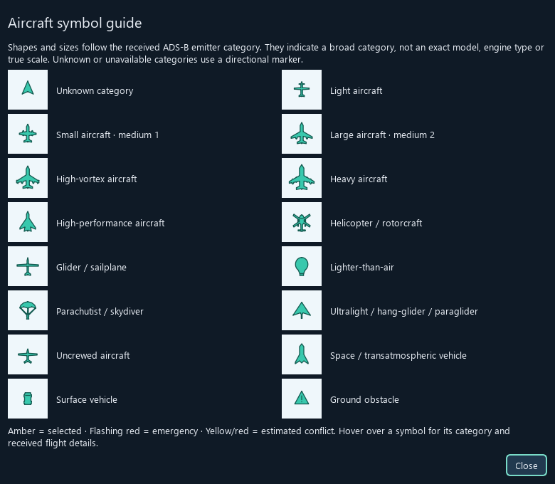
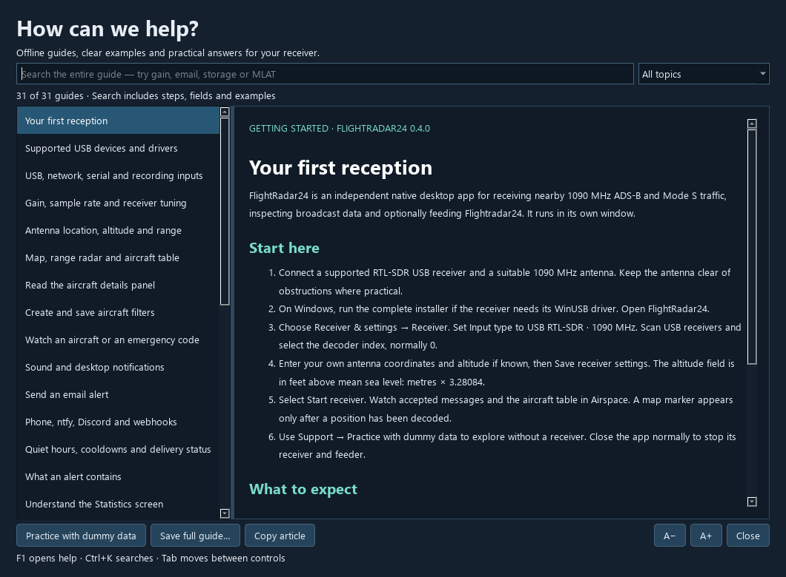
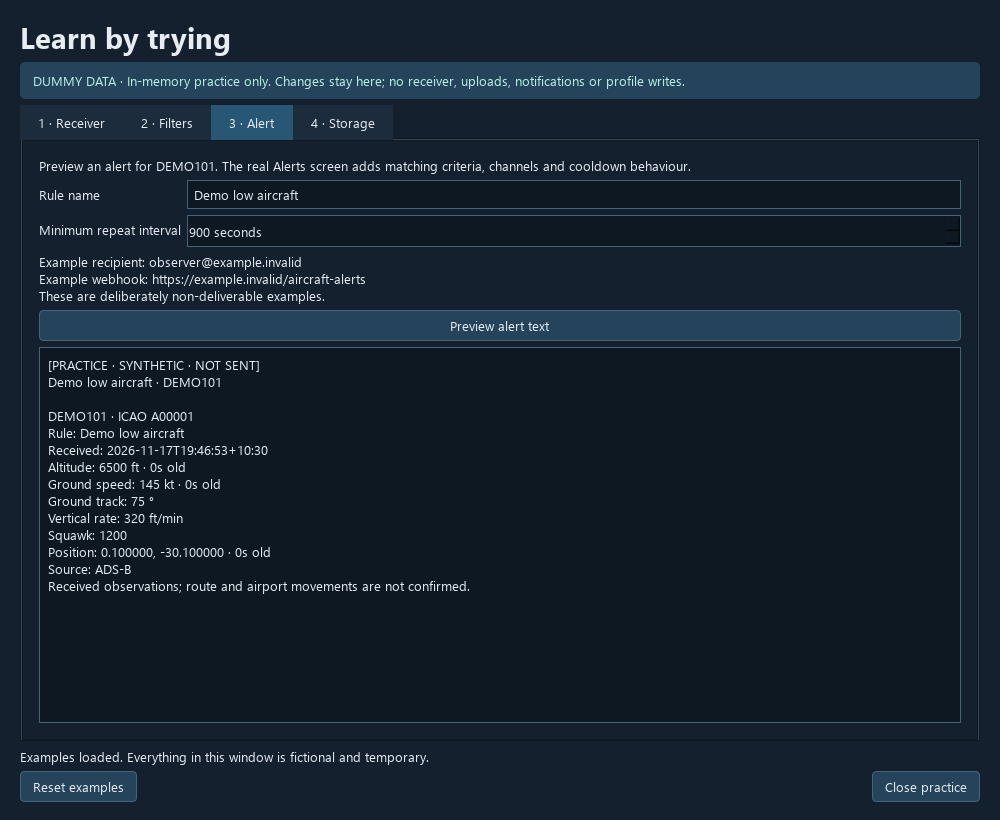

# FlightRadar24

**Your receiver. Your airspace. A native desktop view.**

FlightRadar24 is an independent, open-source ADS-B and Mode S desktop application by **Kieran O'Rourke**. Connect a compatible 1090 MHz receiver or aircraft-data stream, watch received aircraft on a worldwide map, inspect live broadcast details, create alerts and explore local reception statistics.

The application uses **native Qt Widgets**. It opens in its own program window, with no Chrome, WebView or browser engine. Windows x64 is the tested target. Linux x86-64 support is in development; macOS is a future option.

## Download for Windows

### [Download FlightRadar24 0.8.2 — Windows x64 installer (.exe)](https://github.com/ufo8mycow14/FlightRadar24---Contributor-Windows-Linux-App/releases/download/v0.8.2/FlightRadar24-0.8.2-Windows-x64-Setup.exe)

[All release files and checksums](https://github.com/ufo8mycow14/FlightRadar24---Contributor-Windows-Linux-App/releases/tag/v0.8.2) · [Installation guide](docs/RELEASE.md)

Download the installer, run it, then open **FlightRadar24** from the Start menu. Python and a browser are not required. Setup includes the app and offline USB driver components. To share reception with Flightradar24, select **Install optional Flightradar24 sharing** during setup; that component downloads directly from its vendor and requires internet access. You can also add it by running setup again later.

This release is for **64-bit Windows**. It is unsigned; no verified-publisher certificate is claimed. Linux binaries and a macOS installer are not available yet.

> This community project is not affiliated with or endorsed by Flightradar24 AB. The optional official feeder is proprietary and separately licensed. It is obtained directly from Flightradar24, not redistributed in our installer. The app, dependency source archives, build instructions and licences are available with the release.

## USB receivers

Use a suitable **1090 MHz antenna**. A receiver listing alone does not prove that its tuner or driver can receive aircraft.

| USB device / family | Support status | Driver notes |
| --- | --- | --- |
| **RTL-SDR Blog V4** | Live reception tested on Windows x64 | WinUSB on the SDR interface; the decoder includes Blog V4 support. |
| **A12E RTL2832U ADS-B / Mode-S (`0BDA:2832`)** | Live reception tested on Windows x64 | Single-interface WinUSB setup is supported by the updated driver helper. Included in the 0.8.2 installer. |
| **RTL2832U with R820T / R820T2** | Intended compatible family; each other model remains unverified on hardware | Includes common Blog V3-style and generic RTL-SDR dongles when their hardware/IDs are compatible. |
| **USB IDs `0BDA:2832` and `0BDA:2838`** | Composite interface 0; also single-interface `0BDA:2832` | Complete Windows setup checks these devices and preserves an existing working WinUSB binding. Composite parents and other interfaces are excluded. |
| Other receivers with **Beast, AVR or SBS** output | Use the supported network/serial input instead of direct USB | Decoded SBS is display/SBS-forwarding only; it cannot reconstruct raw frames or feed the vendor service. |

Direct USB support is **not implemented** for Airspy, HackRF, SDRplay, 978 MHz UAT or Kinetic proprietary binary modes. The full Windows package uses an offline libwdi helper and Microsoft's inbox WinUSB driver; generated device-specific catalogues are locally signed, not WHQL certified. Portable/source builds do not install drivers themselves.

## Features

- **Two-monitor workspace.** Detach the Aircraft table into a separate window and use Move to monitor or drag it to a second display. F11 puts either window in full screen; Esc exits. Filters, live updates and selection stay synchronised. Dock back or close the table window to return it to the bottom of the map. The layout is remembered, with a docked fallback if a monitor is disconnected.
- **Map-first airspace view.** The worldwide map fills the home screen; reception and sharing status run across the very top bar, the aircraft list with Find and filters floats in a box along the bottom spanning the map, clicking a plane pops its live details up in a compact floating box at the left, and zoom, antenna and fit controls sit on the map itself. Dotted 50 NM range rings, N/E/S/W cardinals and a compass (true or magnetic north, using your entered variation) replace the old separate radar box, and work without map tiles. Map tiles use OpenStreetMap with visible attribution.
- **Airspace workspace.** Aviation or metric units with flight levels, distance/bearing from your antenna, climb/descent trend arrows, flashing-red emergency aircraft, Find (Ctrl+F), a sortable aircraft table, follow-selected map centring and a remembered window layout. Display choices never change reception, uploading or recorded history.
- **Live aircraft details.** Callsign, ICAO24 address, squawk, position, altitude, ground speed, track, vertical rate, source and measurement ages. Expanded groups show additional broadcast fields when available.
- **Flexible display filters.** Callsigns/prefixes, exact ICAO24 addresses, squawks, altitude, speed, distance, emitter category, source, ground/airborne state, position and emergencies. Save named presets.
- **Aircraft watches and alerts.** In-app history, system sound, native desktop notification requests and optional TLS email or HTTPS ntfy/Discord/generic webhook delivery. Cooldowns, quiet hours and rate limits control noise.
- **Reception statistics.** Aircraft encounters show when each callsign was last received, days ago and the number of separate encounters for that ICAO24 across retained history. Older approximate callsign dates are marked ≈. Live reception and recorded playback stay separate.
- **Worldwide airport reference.** Offline search across 5,282 large and medium airports, plus manual entries. Proximity counts show nearby reception, not confirmed arrivals or departures.
- **Controlled storage.** Set history age/size, snapshot interval and rotating-log limits. Oldest managed history is pruned automatically. CSV exports remain under your control.
- **Multiple sources and outputs.** USB RTL-SDR, Beast/AVR TCP or serial, SBS TCP and unsigned 8-bit I/Q playback; configurable RAW, SBS and timestamped Beast outputs.
- **Optional Flightradar24 sharing.** Protected sharing-key storage, official registration integration, feeder supervision and connection/MLAT monitor values after installing the optional sharing component.
- **Offline Support centre.** Search the full guide, browse topics, save it to Markdown and use interactive prefilled dummy examples. F1 opens help.
- **Private-by-default setup.** No default external alert recipient, local-only stream binding and no automatic support submission. A safe support template contains version/platform information without station details.

Filters affect display/export only. Hidden traffic is still received, counted, evaluated for alerts and uploaded when sharing is enabled.

## A look inside





*The native Support centre. The guide is bundled with the application and works offline.*



*Synthetic practice data, not a real aircraft report. This workspace cannot send alerts, open a radio or modify the live profile.*

## Try the source application

Use **64-bit Python 3.12**. The source UI, help, practice and supported network/serial inputs do not require a bundled USB decoder. USB/IQ decoding, official registration/upload and a complete offline installer require separately prepared native components; see [Building](BUILDING.md).

```powershell
git clone https://github.com/ufo8mycow14/FlightRadar24.git
cd FlightRadar24
py -3.12 -m venv .venv
.\.venv\Scripts\python.exe -m pip install -r requirements.txt -r requirements-desktop.txt
.\.venv\Scripts\python.exe src/launcher.py --practice
```

The practice workspace starts with fictional aircraft and prefilled receiver, filter, alert and storage examples. It creates no profile and makes no network requests. To open the full desktop application:

```powershell
.\.venv\Scripts\pythonw.exe src/launcher.py
```

`pythonw.exe` avoids a persistent console window. A packaged build uses the windowed `FlightRadar24.exe`. Choose a source under **Receiver & settings**, save, then **Start receiver**. Do not use the example antenna coordinates for a real receiver.

Linux uses the equivalent virtual-environment commands with `python3` and `.venv/bin/python`. A graphical session and Qt system dependencies are required. Linux runtime/hardware tests remain outstanding.

## Keep the app up to date

Open **Support → Software updates**, or **Updates** in the bottom bar. The Windows app checks published GitHub releases every 12 hours while running and checks at startup when overdue. Checks can be disabled; no background service runs while the app is closed.

Choose **Download update**, then **Install and restart**, or opt into **Automatically download and install updates**. Automatic installation is off by default, provides a 60-second countdown and a **Postpone this version** option, and waits while settings are being edited. The download's size and SHA-256 digest must match GitHub. Saved settings/history are retained and reception resumes if it was running. Windows elevation prompts still apply. A Git push alone does not distribute an update: publish a stable release with its matching Windows installer.

## Aviation waypoints

Use **WPT** on the map or **View → Aviation waypoints** to turn the layer on or off. The choice is saved. Zoom in for named markers and hover for coordinates/source; aircraft retain selection priority.

The bundled Australia-region layer contains 5,185 **historical October 2013** fixes, clearly dated on the map. It is a reference snapshot, not current AIRAC/navigation data. **View → Aviation waypoint data** imports a newer CSV or X-Plane/FlightGear fix file you are entitled to use, or switches back to the bundled reference. Imports remain in the local profile. See [waypoint data and import formats](docs/WAYPOINTS.md).

## Aircraft symbols, labels, hover and estimated conflicts

Distinct vector silhouettes and sizes show the received aircraft category, including helicopters, light aircraft, larger aircraft, heavy aircraft and gliders. **View → Aircraft symbol guide** explains all symbols. Unknown categories use a directional marker; symbols are broad categories, not exact models, propulsion types or true scale. Hover details identify the symbol category.

Open **View → Map labels & conflict display** for individual map-label fields: callsign, ICAO, altitude, ground speed, track, vertical rate, squawk, antenna distance and last-seen age. Choose **Custom** and tick only the fields you want, then **Save display settings**. Presets and hidden labels remain available. Hover over a plane or its label for more received information; click to open its full details.

Fresh airborne observations can produce **yellow or red estimated-conflict warnings on both aircraft**. The app checks projected horizontal and vertical proximity together, using TCAS II reference thresholds with a documented low-altitude fallback. Estimates include aircraft hidden by filters; stale, incomplete and ground observations are counted as unassessed. Emergency broadcasts keep red priority. Estimates and flashing each have their own on/off control.

These ground-display estimates are not airborne TCAS, confirmed collision courses or manoeuvre guidance. Read the [thresholds, primary references and limitations](docs/CONFLICT-ALERTS.md). Missing reception can hide a conflict.

## What the receiver can tell you

The app displays the **data actually received**. A map that works worldwide does not mean the application downloads all worldwide flights. Coverage comes from your antenna or selected stream.

Many messages omit position or particular measurements. Missing or expired values are not guessed. Emitter category is not an aircraft model. Airline, registration, model, aircraft age, routes, schedules, passenger details and photos require other data sources and are not provided by this receiver-only implementation.

A unique-aircraft count means distinct ICAO24 addresses. An encounter is separated by a 20-minute reception gap; it is not necessarily one flight. Airport proximity is not evidence of departure, arrival, origin or destination. This is hobby monitoring software, not a navigation or safety-of-flight service.

## Alerts without an app subscription

Local sound and desktop alerts need no external account. For remote alerts, use your own SMTP account, an ntfy topic, a Discord webhook or an HTTPS JSON endpoint. Provider free tiers, limits, privacy and phone background delivery vary; the app itself adds no alert subscription.

An alert includes the rule, received identity, timestamp, available position and motion data, source and measurement ages. Quiet hours retain events but silence delivery. Service acceptance is distinguished from actual inbox/phone delivery. External channels remain disabled until you configure them.

Open **Alerts** for rules and **Receiver & settings → Storage & alerts** for delivery settings. [The full alert guide](docs/USER-GUIDE.md#alerts) explains setup and tests.

## Statistics and disk use

| Managed data | Default | User control |
| --- | --- | --- |
| History database plus journal | 256 MiB, 30 days | 8–4096 MiB; 1–3650 days; recording on/off |
| Per-aircraft snapshot interval | 15 seconds | 5–300 seconds |
| Rotating diagnostic logs | 20 MiB | 1–1024 MiB; rotated-log age 1–365 days |
| Rotated-log age | 3 days | Configurable |
| Map tiles | 64 MiB | Separate fixed cache cap |

Statistics come from structured observations, independently of log files. Part of the history budget is reserved for safe SQLite writes. A full/unavailable disk reports lost history while reception continues. Exports, backups, recordings, installers and build files are outside managed budgets. [Storage guide](docs/USER-GUIDE.md#storage).

## Help and support

- **Support → Search help** or **F1**: complete offline user guide with full-text search and categories.
- **Support → Practice with dummy data**: editable examples, filter results and an alert preview without live side effects.
- **Support → About**: running version, Kieran O'Rourke, licence and project information.
- [User guide](docs/USER-GUIDE.md): same content as the application help.
- [Report an issue](https://github.com/ufo8mycow14/FlightRadar24/issues): include version, platform, steps, expected behaviour and the observed error. Review attachments first; never post receiver keys, passwords, station coordinates or your whole profile.
- [Contributing](CONTRIBUTING.md): development and documentation changes.

Support copies project/issue addresses for you to open separately; it never launches a browser automatically or submits a report.

## Project status

| Area | Evidence / limitation |
| --- | --- |
| Windows x64 native app | Built and exercised on Windows, with live RTL-SDR Blog V4 reception in the development installation. |
| Filters, history and storage | Automated validation includes stale/missing values, retention, bounded storage and isolated playback. |
| Native support and practice | Search/navigation, validation, filter evaluation and side-effect isolation tested. |
| Flightradar24 upload | Previously corroborated by vendor reports and the owner's account-side online/recent-data confirmation for one installation. |
| MLAT | Active vendor MLAT remains unverified. |
| External email/phone delivery | Tests use mocked services; actual destinations and phone/inbox receipt require user setup and verification. |
| Linux x86-64 | Source/build path present; target runtime and hardware verification outstanding. |
| macOS | Future option. |

## Licence and credits

Copyright © 2026 **Kieran O'Rourke**. Project-authored controller/UI and documentation are open source under the **GNU General Public License, version 3 or later**. See [LICENSE](LICENSE) and [COPYRIGHT](COPYRIGHT).

Third-party code/data retain their own terms. The optional official feeder is proprietary and is **not included** in the public source repository. Qt/PySide6, pyModeS, pyserial, decoder/runtime components, OurAirports and OpenStreetMap are credited in [Third-party notices](THIRD-PARTY-NOTICES.md). Publishing source does not grant rights to redistribute every optional binary dependency.
